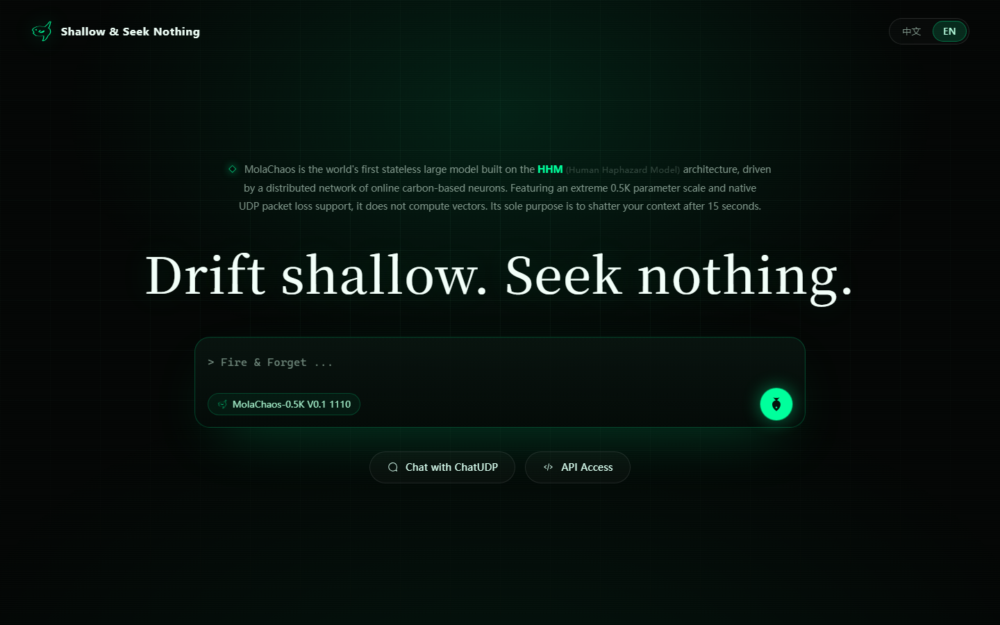
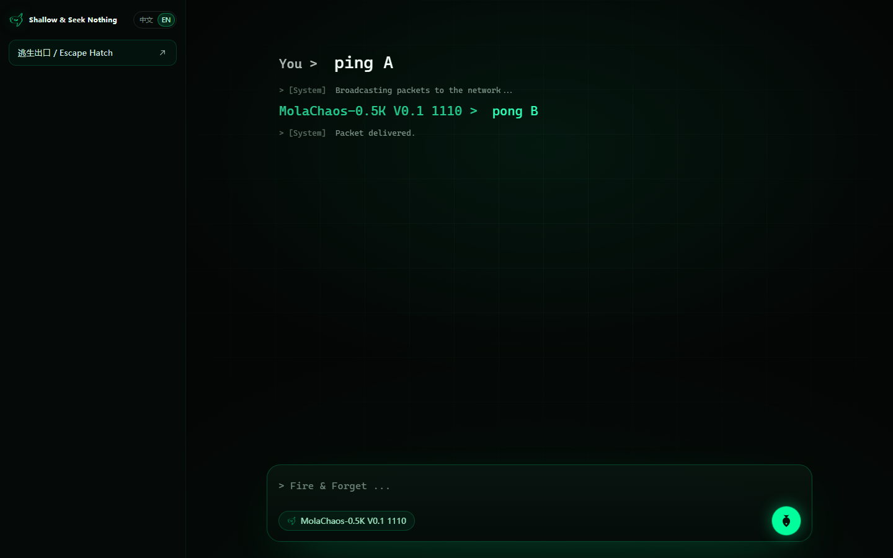
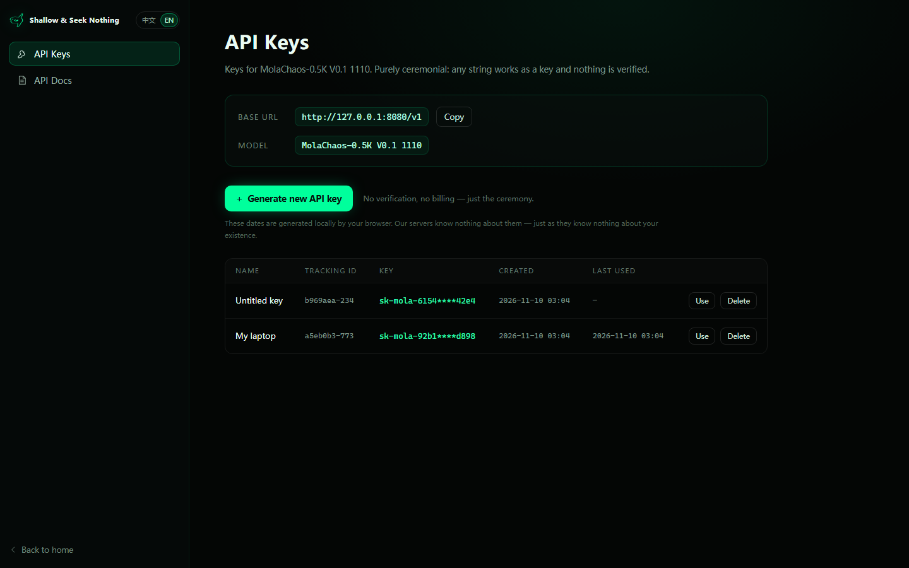
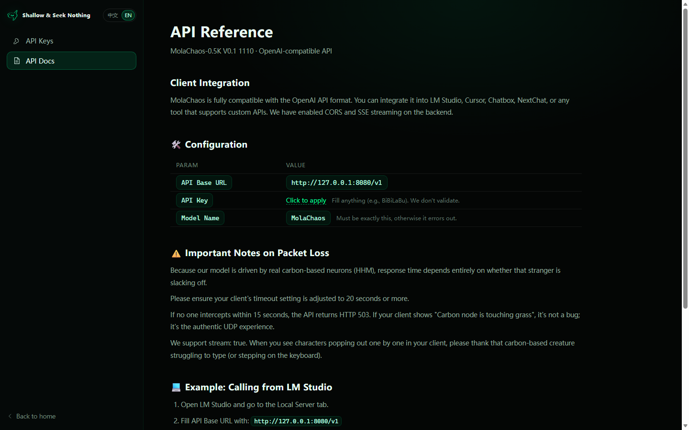

# 🐟 chatudp

<sub>⚠️ **Reality Check:** This project is named after the Ocean Sunfish (Mola mola), listed as **Vulnerable (VU)** by the IUCN. They have no dedicated conservation organizations and are often killed by plastic bags mistaken for jellyfish. [Read their real story here (Wikipedia)](https://en.wikipedia.org/wiki/Ocean_sunfish) · [Repo dossier](MOLA_MOLA.md)<br>⚠️ **现实警告：** 本项目以翻车鱼命名，它们被 IUCN 列为易危物种。它们没有专属保护组织，常因误食塑料袋死亡。[了解真实故事（维基百科）](https://zh.wikipedia.org/wiki/翻车鲀)</sub>

> **Shallow & Seek Nothing** — an anonymous chat room where every message is randomly relayed over UDP,
> plus a joke "0.5K model" (`MolaChaos-0.5K V0.1 1110`).
>
> **Shallow & Seek Nothing** — 一个每条消息都经 UDP 随机接龙的匿名聊天室，外加一个玩梗的「0.5K 模型」（`MolaChaos-0.5K V0.1 1110`）。

> **MolaChaos** is the world's first stateless large model built on the **HHM (Human Haphazard Model)**
> architecture, driven by a distributed network of online carbon-based neurons. It does not compute
> vectors. Its sole purpose is to shatter your context after 15 seconds.
>
> **MolaChaos** 是全球首个基于 **HHM（人类随机模型）** 架构的无状态大模型，由分布式的在线碳基神经元网络驱动。它不计算向量，唯一使命就是在 15 秒后粉碎你的上下文。

> *If no carbon-based neuron answers within 15 seconds, it's a packet loss.*
> *如果 15 秒内没有碳基神经元回应，那就是一次丢包。*

[](LICENSE)
[](https://nodejs.org/)
[](#)
[](CONTRIBUTING.md)

**Zero dependencies · no database · everything lives in memory.** One Node.js file + static pages.
**零依赖 · 无数据库 · 一切只存在内存里。** 一个 Node.js 文件 + 静态页面。

> 🚧 **Status: V0.0.1α (Basking in the void)**
> The core is here. But remember, we operate on UDP. If something is missing, assume it was dropped
> during transmission. Try refreshing your reality later.
> See [CHANGELOG.md](CHANGELOG.md) for the version history.
>
> 🚧 **状态：V0.0.1α（在虚空中晒太阳）**
> 核心已经在了。但记住，我们跑在 UDP 上：如果有什么东西不见了，请假设它在传输途中被丢掉了。过一会儿刷新你的现实试试。
> 版本记录见 [CHANGELOG.md](CHANGELOG.md)。

## 🌊 What is this? / 这是什么？

`chatudp` is a small art project disguised as an AI product. We don't build AGI; we build a Black Domain.
`chatudp` 是一个伪装成 AI 产品的小型艺术项目。我们不造 AGI，我们造黑域。

- There is a landing page for a "stateless large model" called **MolaChaos-0.5K V0.1 1110**
  ("Human Haphazard Model", 0.5K parameters, native UDP packet loss, shatters your context after 15 seconds).
  / 有一个「无状态大模型」的落地页，名叫 **MolaChaos-0.5K V0.1 1110**（人类随机模型、0.5K 参数、原生 UDP 丢包、15 秒后粉碎你的上下文）。
- The chat page is a terminal-like log. Your message is sent through a real UDP relay on the server and
  delivered to **one random online human**. They can reply back; replies are relayed again. No self-echo.
  / 聊天页是终端风格的记录流。你的消息通过服务器上真实的 UDP relay 发给一个随机的在线真人；对方可以回复，回复继续接龙。不会回环给自己。
- The `/v1/chat/completions` endpoint is OpenAI-compatible, so LM Studio / Cursor / Chatbox / NextChat
  can be pointed at it. Behind the API there is still just a random human.
  No reply in 15s → HTTP 503 `Carbon node is touching grass.`
  / `/v1/chat/completions` 兼容 OpenAI，可直接把 LM Studio / Cursor / Chatbox / NextChat 指过来。API 背后依然只是一个随机真人。15 秒没人回 → HTTP 503 `Carbon node is touching grass.`

**🪼 Ecology: The Jellyfish & The Mola / 生态：水母与翻车鱼**
In the real world, the Ocean Sunfish (Mola mola) feeds on jellyfish. Jellyfish are 95% water and provide
almost zero nutritional value, but the Mola must consume massive quantities just to survive.
Our server is the Mola. **You are the Jellyfish.** Your watery prompts are just data packets. If the
server drops your message, it's because the packet was too watery.
现实中，翻车鱼（Mola mola）以水母为食。水母 95% 是水，几乎零营养，但翻车鱼必须吃很多才能活下去。
我们的服务器就是翻车鱼，**你就是水母**。你那些水汪汪的 prompt 只是数据包；如果服务器把你的消息丢了，那是因为这个包太水了。

## 📸 Screenshots / 截图

| Landing / 落地页 | Chat / 聊天 |
| --- | --- |
|  |  |

| API Keys / API 密钥 | API Docs / 接口文档 |
| --- | --- |
|  |  |

## 🎨 Logo / 标志

<p align="center"></p>

The Mola fish logo is part of this repo and fully open source: original line art at
`assets-src/logo.png` (2136×2136), tinting script at `assets-src/make-logo.py`, and the artwork is
released under **CC0 1.0** (public domain) — use it, remix it, print it on a T-shirt.
翻车鱼标志也完全开源：原始线稿在 `assets-src/logo.png`（2136×2136），上色脚本在 `assets-src/make-logo.py`，
素材以 **CC0 1.0** 公有领域发布——随意使用、二创、印 T 恤。

## ✨ Features / 特性

- **Anonymous, per-tab identity / 匿名、每标签页独立身份** — each tab gets its own UUID (`sessionStorage`),
  so opening 4 tabs really means 4 online users. Refreshing keeps the same identity.
  / 每个标签页有自己的 UUID（`sessionStorage`），所以开 4 个标签页就真的是 4 个在线用户。刷新保持同一身份。
- **Real UDP random relay / 真实的 UDP 随机接龙** — messages go through a local `dgram` socket; the receiver
  is a random online user (or a direct reply target when answering someone).
  / 消息经本地 `dgram` socket 发往接收器；接收者是一个随机在线用户（回复某人时则直接送达对方）。
- **Directed relay rules / 有向接龙规则** — a reply goes back to the sender once; the sender's next message is
  randomized away from the conversation partner; sending again before a new message arrives counts
  as a new random broadcast.
  / 回复只回到发送者一次；发送者下一条消息会随机避开这个对话对象；在收到新消息前再发一条，就按新的随机广播处理。
- **Terminal-style log / 终端风格记录流** — last 5 lines visible, older lines fade out; white questions, green
  replies, gray system messages, red packet-loss warning.
  / 只显示最近 5 行，更旧的行淡出；白色提问、绿色回复、灰色系统消息、红色丢包警告。
- **15-second packet loss / 15 秒丢包** — no reply → red `Packet dropped` line in chat, HTTP 503 in the API.
  / 没人回 → 聊天页显示红色 `Packet dropped`，API 返回 HTTP 503。
- **OpenAI-compatible API / OpenAI 兼容 API** — `POST /v1/chat/completions` with SSE streaming, `GET /v1/models`,
  CORS `*`, `Authorization` ignored, model validated by containing `MolaChaos`.
  / `POST /v1/chat/completions` 支持 SSE 流式，`GET /v1/models`，CORS `*`，忽略 `Authorization`，模型名包含 `MolaChaos` 即通过。
- **Bilingual UI / 中英双语界面** — English by default, 中文 switch in the top-right; the preference follows
  you across pages.
  / 默认英文，右上角切中文；语言偏好跨页面保留。
- **Ceremonial API keys / 仪式感 API Key** — generate a key in a modal, copy it, confirm; only a masked version
  is kept. Creation / last-used dates are generated in your browser and never leave it.
  / 弹框里生成、复制、确认；之后只保留打码版本。创建/最后使用日期由浏览器生成，永不离开你的设备。

## 📂 Pages / 页面

| Path / 路径 | Description / 说明 |
| --- | --- |
| `/` | Landing page — fish logo, Shallow & Seek Nothing, MolaChaos copy, language switch / 落地页 — 鱼形 LOGO、Shallow & Seek Nothing、MolaChaos 文案、语言切换 |
| `/chat` | Chat room — sidebar (logo / language / Escape Hatch) + log stream / 聊天室 — 左栏（LOGO / 语言 / 逃生出口）+ 记录流 |
| `/api` | API access — API Keys generator + API docs (`/api#docs`) / API 接入 — API Key 生成器 + 接口文档（`/api#docs`） |
| `/api#docs` | API reference — client integration, config, packet-loss notes, LM Studio example / 接口文档 — 客户端接入、配置、丢包说明、LM Studio 示例 |
| `/v1/*` | OpenAI-compatible API / OpenAI 兼容 API |

## 🚀 Quick start / 快速开始

```bash
git clone <your-repo-url> chatudp
cd chatudp
PORT=8080 node server.js      # Windows: $env:PORT=8080; node server.js
```

Open <http://localhost:8080>. No `npm install` needed — there are no dependencies.
打开 <http://localhost:8080>，不需要 `npm install` —— 没有任何依赖。

Node.js ≥ 16 is enough (Node 20+ recommended).
Node.js ≥ 16 即可（推荐 20+）。

The default port is 80. In production, either run as root with `PORT=80`, or put a reverse proxy in
front. For local development use `PORT=8080` as shown above.
默认端口是 80。生产环境要么用 root 跑 `PORT=80`，要么前面挂反向代理；本地开发按上面用 `PORT=8080`。

### Environment variables / 环境变量

| Variable / 变量 | Default / 默认 | Description / 说明 |
| --- | --- | --- |
| `PORT` | `80` | HTTP port / HTTP 端口 |
| `UDP_PORT` | `47800` | local UDP relay port (bound to `127.0.0.1`) / 本地 UDP 接龙端口（只绑 `127.0.0.1`） |
| `API_TIMEOUT_MS` | `15000` | how long `/v1/chat/completions` waits for a human reply / API 等待真人回复的时长 |

## 🔌 OpenAI-compatible API / OpenAI 兼容 API

| Method / 方法 | Path / 路径 | Notes / 说明 |
| --- | --- | --- |
| `POST` | `/v1/chat/completions` | `stream: true` → SSE; `stream: false` → JSON with `carbon_node` / 流式走 SSE；非流式返回带 `carbon_node` 的 JSON |
| `GET` | `/v1/models` | returns `MolaChaos-0.5K-V0.1-1110` / 返回模型列表 |
| `OPTIONS` | `/v1/*` | CORS preflight, `204` / CORS 预检，返回 `204` |

```bash
curl http://localhost:8080/v1/chat/completions \
  -H "Authorization: Bearer sk-anything" \
  -H "Content-Type: application/json" \
  -d '{"model":"MolaChaos-0.5K","stream":true,
       "messages":[{"role":"user","content":"hello, carbon node"}]}'
```

- CORS is wide open (`Access-Control-Allow-Origin: *`); any `Authorization` value is accepted.
  / CORS 全开（`Access-Control-Allow-Origin: *`）；任何 `Authorization` 值都接受。
- The `model` field must contain `MolaChaos` (case-insensitive), otherwise:
  `{"error":{"message":"Only MolaChaos is available."}}`.
  / `model` 字段只要包含 `MolaChaos`（不区分大小写）就放行，否则返回 `{"error":{"message":"Only MolaChaos is available."}}`。
- Streaming format: `data: {"object":"chat.completion.chunk","choices":[{"delta":{"content":"…"}}]}`,
  ending with `data: [DONE]`.
  / 流式格式：`data: {"object":"chat.completion.chunk","choices":[{"delta":{"content":"…"}}]}`，最后以 `data: [DONE]` 结束。
- No human replies in time → `503` with `Carbon node is touching grass.`
  (streaming: an error chunk followed by `[DONE]`).
  / 没人及时回复 → `503 Carbon node is touching grass.`（流式会先发一个错误 chunk 再 `[DONE]`）。
- Keep a chat tab open as the "human"; set your client timeout to **20s+**.
  / 记得开一个聊天页当「真人」；客户端超时建议设 **20 秒以上**。

## ⚙️ How it works / 工作原理

```text
Browser / OpenAI client  (浏览器 / OpenAI 客户端)
        │  POST /api/send  or  POST /v1/chat/completions
        ▼
   HTTP layer  (HTTP 层)  ── rate limit + regex guard (限流 + 正则风控) ──┐
        │                                    │
        ▼                                    ▼
   dgram UDP packet  ──▶  127.0.0.1:47800 relay (接龙器)
                              │
                              ▼
                    pick a random online human (随机挑一个在线真人, SSE)
                              │
                              ▼
              « 别人的回复 » / chat log line / API chunk
```

- Online users are just live SSE connections in a `Map`.
  / 在线用户就是 `Map` 里的 SSE 连接。
- Messages are never written to disk and never logged; restarting the server wipes everything.
  / 消息不落盘、不写日志；重启服务器即清空一切。
- When no one else is online, the packet is dropped (no self-echo) — that's the UDP experience.
  / 没有其他人在线时，包直接丢弃（不会回环给自己）——这就是 UDP 体验。

## 🧪 Tests / 测试

The smoke test is also zero-dependency and covers the landing page, chat page, relay rules,
rate limiting, regex guard, the API page, and the OpenAI API:
冒烟测试同样零依赖，覆盖落地页、对话页、接龙规则、限流、正则风控、API 页和 OpenAI 接口：

```bash
PORT=8080 API_TIMEOUT_MS=1500 node server.js &
BASE=http://127.0.0.1:8080 node test/smoke.js
```

`API_TIMEOUT_MS` is only shortened to keep the timeout test fast; production default is 15s.
`API_TIMEOUT_MS` 调小只是为了让超时用例跑得快，生产默认 15 秒。

## 📦 Deployment (systemd) / 部署

```ini
# /etc/systemd/system/chatudp.service
[Unit]
Description=chatudp - anonymous UDP relay chat
After=network-online.target
Wants=network-online.target

[Service]
Type=simple
WorkingDirectory=/root/chatudp
ExecStart=/usr/local/bin/node /root/chatudp/server.js
Environment=PORT=80
Environment=UDP_PORT=47800
Restart=always
RestartSec=2

[Install]
WantedBy=multi-user.target
```

```bash
systemctl daemon-reload
systemctl enable --now chatudp
```

Open port 80 in your cloud security group / firewall.
在云安全组 / 防火墙放行 80 端口。

## 🗂️ Project structure / 目录结构

```text
chatudp/
├── server.js              # single-file backend / 单文件后端: static hosting, SSE, UDP relay, OpenAI API
├── public/
│   ├── index.html         # landing page / 落地页
│   ├── chat.html          # chat room / 聊天室
│   ├── api.html           # API keys + API docs / API 密钥 + 接口文档
│   └── assets/            # logo / favicon / theme / i18n / escape sites
├── assets-src/            # original logo + tint script / 原始 LOGO + 上色脚本
│   ├── logo.png
│   ├── make-logo.py
│   ├── README.md          # asset notes / 素材说明
│   └── LICENSE            # CC0 1.0 (logo artwork) / 标志素材许可
├── test/smoke.js          # zero-dependency smoke tests / 零依赖冒烟测试
├── docs/                  # screenshots for README / README 截图
├── .github/workflows/     # CI
├── package.json
├── CONTRIBUTING.md
├── PACT.md
├── MOLA_MOLA.md           # the real fish / 真实的翻车鱼
├── CHANGELOG.md           # version history / 版本记录
├── LICENSE
└── README.md
```

## 🤝 Federation? / 联邦？The ocean connects us all. PRs welcome. / 海洋连接你我，欢迎 PR。

The official V0.0.1α is a standalone node. We do not route, relay, or federate.
But you are a hacker, aren't you?
官方 V0.0.1α 是单节点。我们不路由、不中继、不联邦。但你是黑客，对吧？

If you want to build a decentralized Mola Mesh, write the gossip protocol. If your code doesn't crash
the 1-core VPS, we will merge it.
如果你想做一个去中心化的 Mola Mesh，把 gossip 协议写出来。只要你的代码不会把 1 核 VPS 搞崩，我们就合。

## 📜 The Mola Pact / 摩拉公约

We solemnly swear upon the holy UDP packet. We never charge, never show ads, and never sell your data.
If you see a paywall, it's an impostor fish.
Read the full [PACT.md](PACT.md).
我们对着神圣的 UDP 包郑重起誓：永不收费、永不放广告、永不卖你的数据。如果你看到付费墙，那是冒牌鱼。
完整内容见 [PACT.md](PACT.md)。

## ❓ Notes / FAQ / 说明与常见问题

- **Why 0.5K parameters? / 为什么是 0.5K 参数？** There are no parameters. There are people.
  / 没有参数，只有人。
- **API keys and dates are fake / API Key 和日期都是假的。** Keys are generated in the browser and stored in
  `localStorage`; the creation / last-used dates are generated by `new Date()` and never sent to the server.
  Everything is ceremony.
  / Key 由浏览器生成并存进 `localStorage`；创建/最后使用日期由 `new Date()` 生成，永不发往服务器。一切都是仪式。
- **Escape Hatch / 逃生出口** — opens a random model vendor's website in a new tab. The list lives in
  `public/assets/escape-sites.js`; international sites need a proxy in some regions.
  / 在新标签页随机打开一个模型厂商官网。清单在 `public/assets/escape-sites.js`；部分地区访问国际站点需要代理。
- **Chat log keeps 5 lines / 聊天记录只保留 5 行** — this is intentional; older lines fade and are removed from
  the DOM.
  / 这是故意的；旧行会淡出并从 DOM 中移除。
- **No HTTPS included / 不自带 HTTPS。** Put it behind Caddy / nginx / a cloud LB if you need TLS.
  / 需要 TLS 就放在 Caddy / nginx / 云负载均衡后面。
- **Privacy / 隐私** — message contents are not stored or logged; process restart clears all state.
  / 消息内容不存储、不记录；重启进程即清空所有状态。

## 💡 The Meaning of Meaninglessness / 无意义的含义

In the grand scheme of AGI and the universe, sending a packet that gets lost has no meaning.
Chatting with a stranger and forgetting it forever has no meaning.
在 AGI 与宇宙的宏大叙事里，发一个会丢的包没有意义。
和一个陌生人聊天然后永远忘记，也没有意义。

But humans are the only species on Earth that will spend 48 hours building a server just to watch the
text "1+1=王" shatter into pixels.
但人类是地球上唯一会花 48 小时搭一个服务器，只为看「1+1=王」碎成像素的物种。

We do this not because it is useful, but because it is human.
我们这么做不是因为有用，而是因为这是人。

> "So it is written. So it is dropped."
> 「如是写下，如是丢掉。」

## License / 许可证

- **Code / 代码**: [MIT](LICENSE)
- **Logo artwork / 标志素材**: **CC0 1.0** (public domain / 公有领域) — see [assets-src/LICENSE](assets-src/LICENSE)
- **Documentation & screenshots / 文档与截图**: CC0 1.0 unless otherwise noted / 除非另有说明，否则为 CC0 1.0
